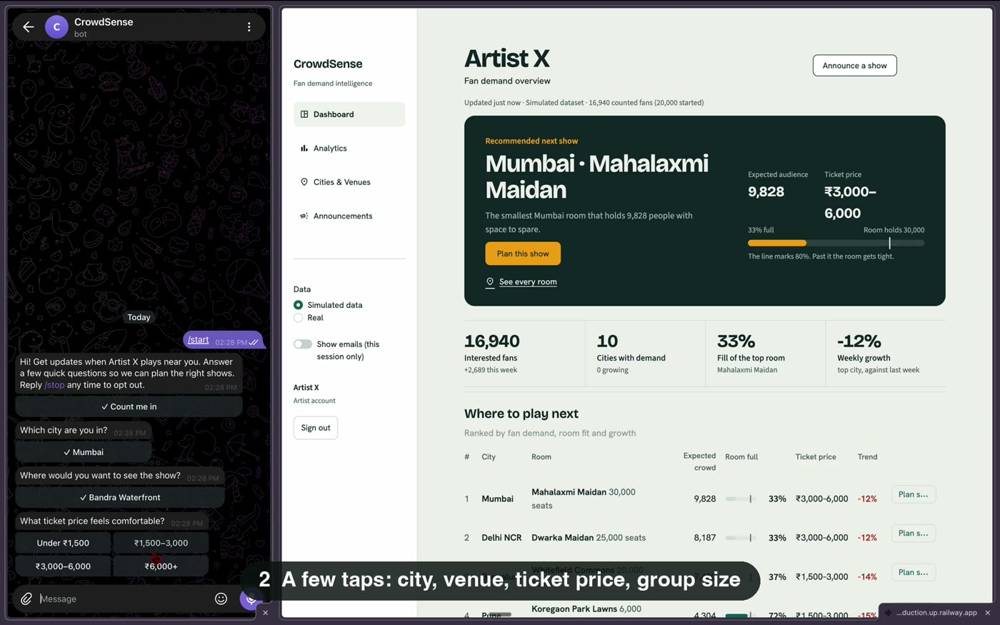
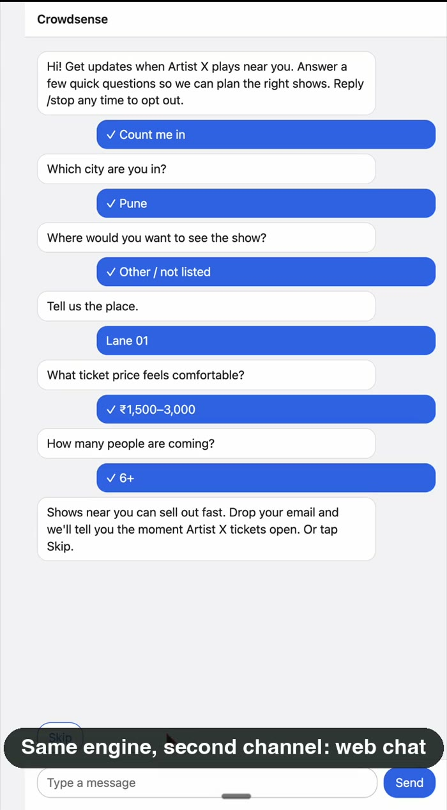
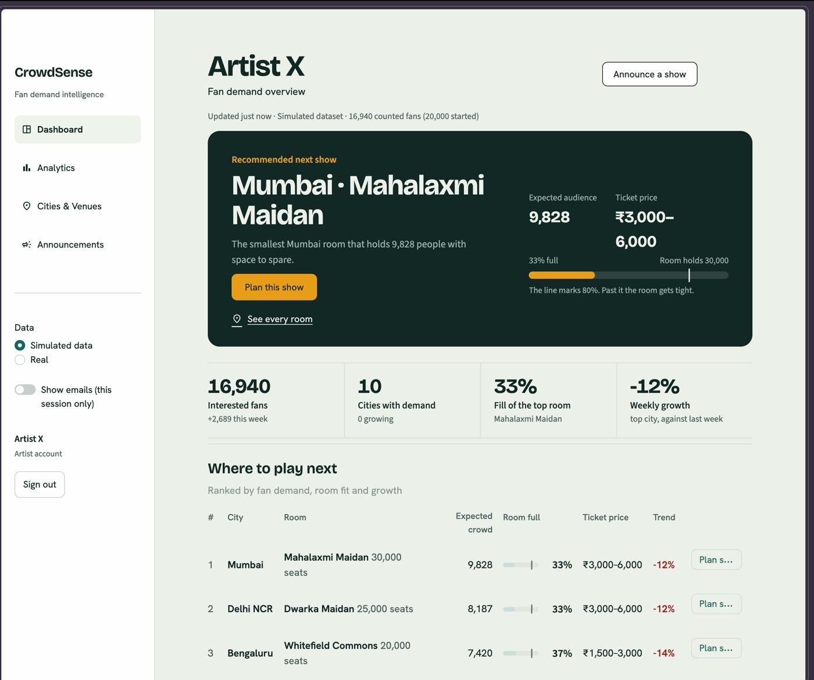
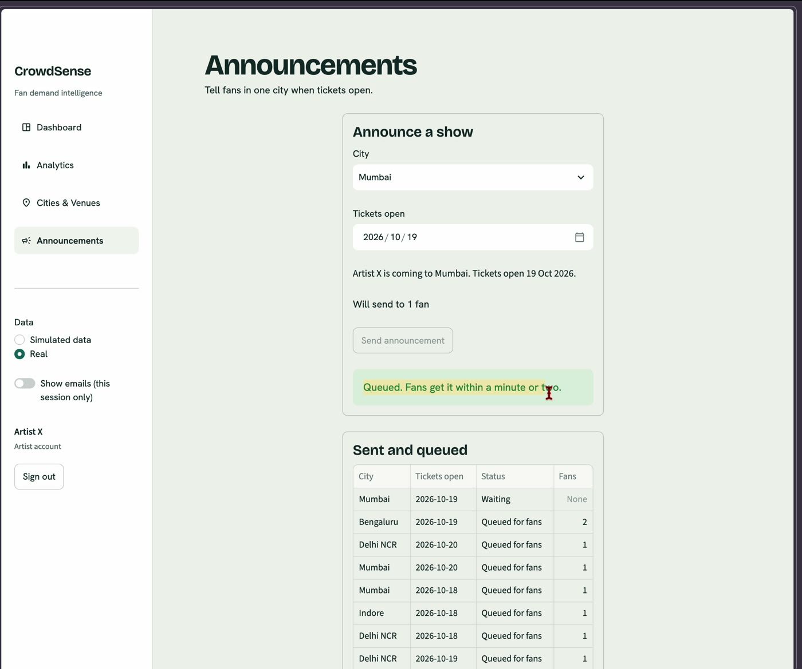

# CrowdSense

[](https://github.com/ishanshaurya/crowdsense/actions/workflows/ci.yml)
[](LICENSE)

**Fans tell a Telegram bot where and how they'd see a show. The artist's dashboard turns those answers into demand, venue, ticket-price and city recommendations, before any venue is booked.**

Proof of concept: a simulated artist, about 20,000 simulated fans and about 10 real testers.

[Try the bot on Telegram](https://t.me/crowdsense_live_bot)

## Demo

**Telegram and dashboard (62 s).** A fan consents and answers a few taps. The artist announces a show to one city, the fan receives it, then `/stop` opts out and `/delete` removes the data.

[](docs/media/crowdsense-demo.mp4)

**Web chat (25 s).** The same engine behind a second channel, including a free-text answer.

[](docs/media/web-chat.mp4)

| Recommendation | Announce a show |
| --- | --- |
|  |  |

The dashboard sits behind a password. Access is available on request.

## Problem and MVP scope

Artists book venues on guesswork. CrowdSense measures stated demand first, using a chat fans already use.

**Core flow:** entry link → consent → city, venue, ticket price, group size (email optional) → counted fan → artist dashboard → one announcement to a city → `/stop` or `/delete` at any time.

| In the MVP | Deliberately out |
| --- | --- |
| Telegram bot and web chat | WhatsApp, Instagram, Discord channels (parked, #7) |
| Demand, venue, price and city recommendations | Ticket sales and payments |
| One announcement per city, to consenting real fans | Campaigns beyond announcements (#64) |
| Simulated and Real data views | Merging one person across channels (#37) |

## Architecture

```
 Fan on Telegram        Fan on web chat
        │ webhook              │ POST /chat/message
        ▼                      ▼
 ┌──────────────────────────────────────────┐
 │ Webhook service (FastAPI)                │
 │   adapters/  parse ─▶ engine ─▶ send     │
 │   core/      flow, rules, store          │
 └────────────────────┬─────────────────────┘
                      │ write
                      ▼
            ┌───────────────────┐   INSERT announcement_requests
            │ Postgres          │◀───────────────┐  (only write)
            └─────────┬─────────┘                │
                      │ read                     │
                      ▼                          │
 ┌──────────────────────────────────────────┐    │
 │ Dashboard (Streamlit, own DB role)       │────┘
 └──────────────────────────────────────────┘

 announcement_requests ─▶ sweeper ─▶ fan-out to consenting fans ─▶ replies ─▶ sender ─▶ Telegram
```

**One message, end to end**

1. The adapter parses the webhook into a common `InboundEvent`.
2. The engine skips it if `(channel, message id)` was already seen.
3. It finds or creates the fan under a lock, validates the answer, saves it and picks the next step.
4. The turn's replies are saved as `unsent` and committed with the answer in one transaction.
5. After the commit the adapter sends them. A sweeper resends anything still `unsent`.

Details: [`docs/architecture.md`](docs/architecture.md)

## Channels are plugins

Every channel is one adapter file. An adapter translates the channel's messages to the engine's common format and back. It never imports the flow or the engine.

```python
class Adapter(Protocol):
    channel: str
    capabilities: Capabilities

    def authorized(self, headers: Mapping[str, str]) -> bool: ...
    def parse(self, body: Any, received_at: datetime) -> Inbound | None: ...
    def render(self, reply: Reply) -> dict[str, Any]: ...
    async def send(self, external_user_id: str, reply: Reply) -> None: ...
```

| Channel | Status | Needs |
| --- | --- | --- |
| Telegram | Live | Bot token |
| Web chat | Live (second adapter on the same engine, no core change) | None |
| Discord | Planned | Bot token |
| WhatsApp | Planned | Meta business verification, message templates |
| Instagram | Planned | Meta app review |

Adding a channel changes no engine, flow, database or dashboard code. See [`adapters/base.py`](adapters/base.py).

## Production practices

| Area | What is in place |
| --- | --- |
| Idempotent ingestion | `UNIQUE (channel, external_msg_id)`: a retried webhook never asks a fan twice |
| Concurrency | Per-fan lock: two fast taps never create two fans |
| Reliable delivery | Replies commit with the turn and are sent after commit; a sweeper resends failures; Telegram 429s honour `retry_after` |
| Least privilege | The dashboard connects as its own Postgres role. Supabase `anon` and `authenticated` are revoked and checked by script. The only dashboard write is one `INSERT` on `announcement_requests`, guarded by RLS |
| Consent and privacy | Consent first. `/stop` drops unsent messages, `/delete` erases the fan's data, announcements go only to consenting, non-opted-out real fans |
| Architecture rules enforced | `import-linter` fails CI if a layer imports another; a frozen-core check blocks unplanned changes to `core/` |
| Schema management | Versioned Alembic migrations |
| Testing | Integration tests on real Postgres; one store contract suite runs against both Postgres and the in-memory fake |
| CI gates | ruff, mypy (strict), import-linter, pip-audit (dependency CVEs), detect-secrets, lockfile check, Postgres 16 service container |
| CD | Containerised; Railway deploys the API after CI passes |
| Operations | `/health` and `/ready` probes, secrets only through environment variables, pre-commit hooks |
| Decision log | Every decision is numbered and justified in [`docs/decisions.md`](docs/decisions.md) (#1–#115) |

## Measured results

Single machine, Postgres 15 unless noted. Details in [`docs/metrics.md`](docs/metrics.md).

| Metric | Result |
| --- | --- |
| Engine turn p95 (800 turns) | 0.70 ms |
| Dashboard refresh, 20k fans, 12 queries in one round trip | p95 31 ms local; p95 447–601 ms on Supabase from a laptop (network-dominated) |
| Slowest single dashboard query, 20k fans | p95 6 ms local |
| Seed of 20,000 fans through the real engine | 6.4 s |
| New fan visible on the dashboard | 0.55–4.45 s |

**Next (phase 6), not measured yet:** webhook p95 under Locust, 50 msg/s spike, 30-minute soak, chaos tests (duplicates, double taps, crashes, DB outage), a 100,000-fan dashboard run, and a durable inbox so the webhook acknowledges before the engine turn.

## Limits

- **Self-selection bias.** Only fans who open the bot and finish the chat are counted. They are keener than the average fan, so demand is likely overstated.
- **Stated intent is not purchase.** Budget and "would you go" are answers, not sales. Expect a gap between what fans say and what they buy.
- **Simulated data.** About 20,000 of the fans are generated and the dashboard defaults to that view. Only the roughly 10 real testers show in the Real view. Simulated numbers show the system at scale, not real demand.

## Stack

| Layer | Technology |
| --- | --- |
| Bot and web chat | Telegram Bot API over httpx |
| Backend | Python 3.12, FastAPI, uvicorn, Pydantic |
| Database | Postgres (Supabase), psycopg 3, Alembic |
| Dashboard | Streamlit, pandas |
| Delivery | Docker, GitHub Actions, Railway |

## Run it

```bash
cp .env.example .env              # fill in the variable names; never commit .env
uv sync --locked
uv run pytest -q --cov=core --cov-fail-under=90     # starts a local Postgres

# bot + web chat (/chat), then the public tunnel and the Telegram webhook
uv run uvicorn api.webhooks:build_app --factory --env-file .env --port 8000
ngrok http 8000 --url=<host of PUBLIC_URL>
uv run python -m scripts.set_webhook

# dashboard: http://localhost:8501
uv run --env-file .env python -m streamlit run dashboard/app.py
```

Seeding and the dashboard role: "How to run" in [`docs/notes/phase-3.md`](docs/notes/phase-3.md) and [`docs/notes/phase-4.md`](docs/notes/phase-4.md).

## Docs

| File | Answers |
| --- | --- |
| [`docs/prd.md`](docs/prd.md) | What is built and why |
| [`docs/architecture.md`](docs/architecture.md) | Components, data model, flow, failure handling |
| [`docs/decisions.md`](docs/decisions.md) | Every decision, numbered |
| [`docs/metrics.md`](docs/metrics.md) | Load, scale and bot-strength targets and results |
| [`docs/message-script.md`](docs/message-script.md) | What the bot says; messaging error handling |
| [`testing/`](testing) | Test plan per phase, scenarios, traceability |
| [`docs/notes/`](docs/notes) | Per-phase build notes |

## License

MIT
